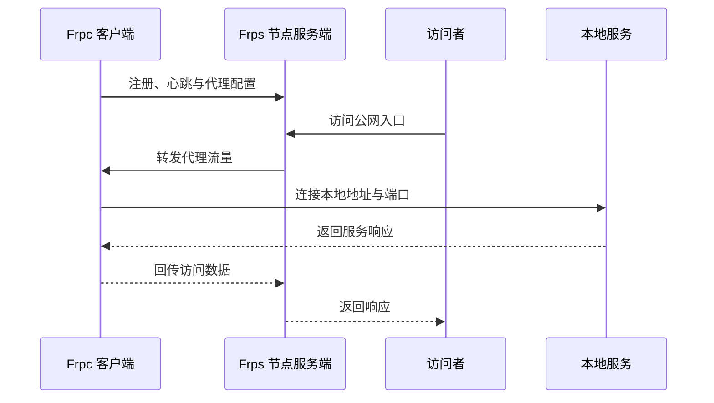

# Frpc 与 Frps

Frp 使用客户端和服务端协作建立转发通道。`Frpc` 是运行在内网设备上的客户端程序，`Frps` 是运行在具备公网入口的服务器上的服务端程序。

在 ME Frp 中，用户通常下载并运行与服务端兼容的 `Frpc`；ME Frp 节点负责运行和维护 `Frps`。使用者一般不需要自行部署 `Frps`。

## Frpc：客户端

`Frpc` 通常运行在提供服务的设备或同一局域网内的设备上。它负责：

- 读取隧道配置和凭据。
- 主动连接 ME Frp 节点。
- 将节点转来的数据送到配置指定的本地 IP 和端口。
- 在网络中断后按客户端策略尝试恢复连接。

例如，本地 SSH 服务监听 `127.0.0.1:22` 时，隧道的本地目标地址应指向运行 SSH 服务的设备和端口。

## Frps：服务端

`Frps` 接收 `Frpc` 的连接，并在节点上提供远程访问入口。它负责识别客户端、登记代理、接收访问流量，并把流量交给对应客户端。

节点的可用协议、端口范围、带宽、域名和访问策略由 ME Frp 的节点与账户配置决定。

## 控制连接与数据流量

Frpc 先建立控制连接，用于认证、心跳和代理管理。访问者发起连接时，节点再将实际数据流量交给对应代理。具体连接复用或传输细节取决于客户端和服务端版本及代理类型。

## 使用哪一个程序

- 普通使用 ME Frp：安装或运行 **Frpc**，按面板生成的配置启动。
- 自行搭建独立 Frp 服务：需要自己部署兼容版本的 **Frps**，并为客户端配置服务端地址和凭据；这不同于使用 ME Frp 公共节点。

不要把客户端版本、服务端版本和 ME Frp 平台版本混为一谈。客户端升级时应使用平台提供或明确支持的版本。

[通用客户端教程](/docs/introduction)　[配置与启动](/docs/guide/configuration)　[术语表](/docs/concepts/terms)
